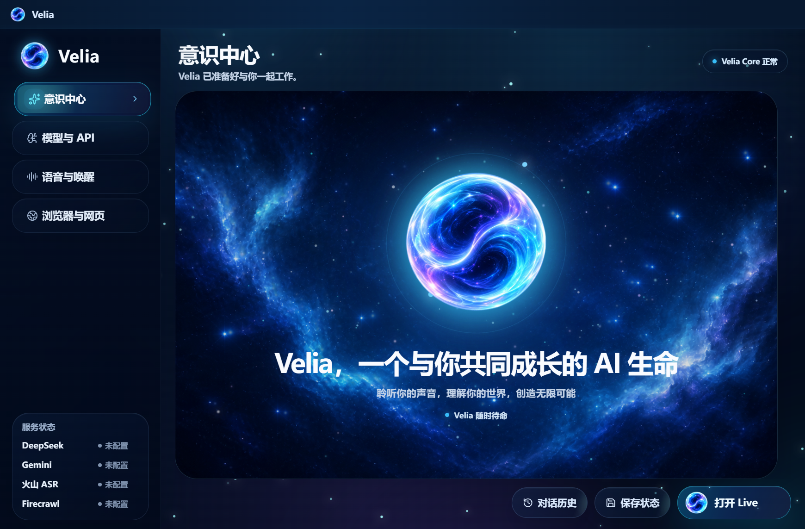

# Velia Computer Voice Assistant

Velia 是一款面向 Windows 的中文语音桌面助手，通过语音交互处理本地轻办公任务，并结合浏览器、文档和屏幕内容提供帮助。

本仓库公开完整的桌面端、UI、可信执行核心、Chrome 扩展、协议与测试。当前版本不需要激活码；第三方 AI 服务的 API Key 由使用者自行申请并在本机配置。



## 当前能力

- 普通按键说话、普通长对话、Gemini Live、“嘿 Velia”本地唤醒。
- 顶部悬浮球，以及聆听、回答等状态反馈。
- Windows 应用的打开、关闭、最小化、恢复，以及本地音量和计时器操作。
- 桌面文件、文件夹和 TXT、Word、Excel 的部分自然语言工作流。
- 通过 Chrome 扩展搜索、读取页面、点击、滚动、返回与关闭标签页。
- 选中文字解释、屏幕理解，以及网页内容整理到文档的工作流。
- 本地加密的对话历史与服务凭据存储。

这些功能受目标软件、窗口状态、网站页面结构和已配置服务影响。Velia 不是能可靠控制所有软件和所有按钮的通用执行器。微信文字输入与自动发送暂不作为支持功能，保留窗口操作能力。

## 运行要求

- Windows x64；本项目使用 Windows UI Automation、DPAPI 和桌面应用接口。
- 具有麦克风和扬声器的电脑。
- 浏览器操作需要 Google Chrome 与仓库内的 Chrome 扩展。
- Word / Excel 工作流需要相应桌面软件；不同 Office / WPS 版本需要单独验证。
- 云端对话、普通语音识别、Live、屏幕理解需要网络及对应服务凭据。

## 从源码启动

先安装 [Git](https://git-scm.com/downloads)、[Node.js 24 或更高版本](https://nodejs.org/) 和 [pnpm 11](https://pnpm.io/installation)。以下命令在 PowerShell 中执行：

```powershell
git clone https://github.com/klkuyth-code/Velia-Computer-Voice-Assistant.git
cd Velia-Computer-Voice-Assistant

# 安装本地 .NET SDK、项目依赖与本地唤醒运行时。
# 首次启用本地唤醒需要下载约 148 MB 的 Whisper 模型。
powershell -NoProfile -ExecutionPolicy Bypass -File .\scripts\setup.ps1 -WithWakeWord

# 构建桌面端和 Core。
.\.tools\dotnet\dotnet.exe build .\core\src\Velia.Core\Velia.Core.csproj --configuration Release
pnpm --dir desktop run build
pnpm --dir desktop start
```

本地 SDK 版本由 `global.json` 固定。`scripts/setup.ps1` 只把 SDK 和唤醒运行时安装到仓库内 `.tools`，不会安装系统服务。

### 配置服务与 Chrome 扩展

启动后进入“模型与 API”，按实际需要配置 DeepSeek、Gemini、火山 ASR 和 Firecrawl。设置方法、服务入口与隐私说明见 [配置指南](docs/CONFIGURATION.md)。

浏览器功能需要在 `chrome://extensions` 开启开发者模式，点击“加载已解压的扩展程序”，选择 `browser-extension/dist`。随后从 Velia 的“浏览器与网页”复制配对令牌，粘贴到扩展中连接。

### 语音入口

- 按住 `F8` 说话；也可在设置中选择 `Ctrl + Shift + 空格`。
- `Ctrl + Alt + L` 开启或停止普通长对话。
- 主页右下角打开 Live。
- 在“语音与唤醒”中启用“嘿 Velia”。

## 测试和打包

```powershell
# 自动测试、构建和 UI 烟测；使用隔离的测试数据目录。
powershell -NoProfile -ExecutionPolicy Bypass -File .\verify.ps1

# 构建可运行目录。
pnpm --dir desktop run package:dir

# 构建 Windows NSIS 安装包。
pnpm --dir desktop run package:win
```

安装包输出到 `desktop/release`。自动测试不调用真实付费模型接口；真实语音、Office 版本差异和第三方网站仍需人工验证。

## 仓库结构

| 目录 | 用途 |
| --- | --- |
| `desktop` | Electron / React UI、语音与窗口宿主 |
| `core` | .NET 可信执行核心、任务调度、模型和本地工具 |
| `browser-extension` | Chrome Manifest V3 扩展 |
| `protocol` | TypeScript / .NET 协议与 JSON Schema |
| `quality` | 跨进程集成测试 |
| `scripts` | 首次配置脚本 |
| `docs` | 配置和架构说明 |

## 数据与隐私

本地唤醒检测在电脑上运行；普通语音识别会发送音频到火山，模型对话会发送文本到相应模型服务，Live 会发送麦克风音频和当前共享画面到 Gemini。文档解析在本地进行，交给模型分析或整理的正文会发送给相应服务。

API Key 和本地历史使用 Windows DPAPI 保护。请不要在 Issue、截图或 Pull Request 中提交 API Key、配对令牌、个人对话或客户数据。完整说明见 [隐私说明](PRIVACY.md)。

## 许可证

Velia 自有代码采用 **Apache License 2.0 + Commons Clause 1.0**，完整条款见 [LICENSE](LICENSE)。这是一项附带商业限制的源码公开许可，不属于 OSI 定义的开源许可证，也不是可任选其一的双许可证。

允许遵循条款的使用、修改和分享；Commons Clause 限制销售主要价值来自 Velia 功能的软件或服务，范围可能包括相关收费托管、咨询和支持。此段为说明，具体以 LICENSE 原文为准。

第三方组件继续遵循各自原许可证。致谢与许可说明见 [THIRD_PARTY_NOTICES.md](desktop/THIRD_PARTY_NOTICES.md) 和 [NOTICE](NOTICE)。
